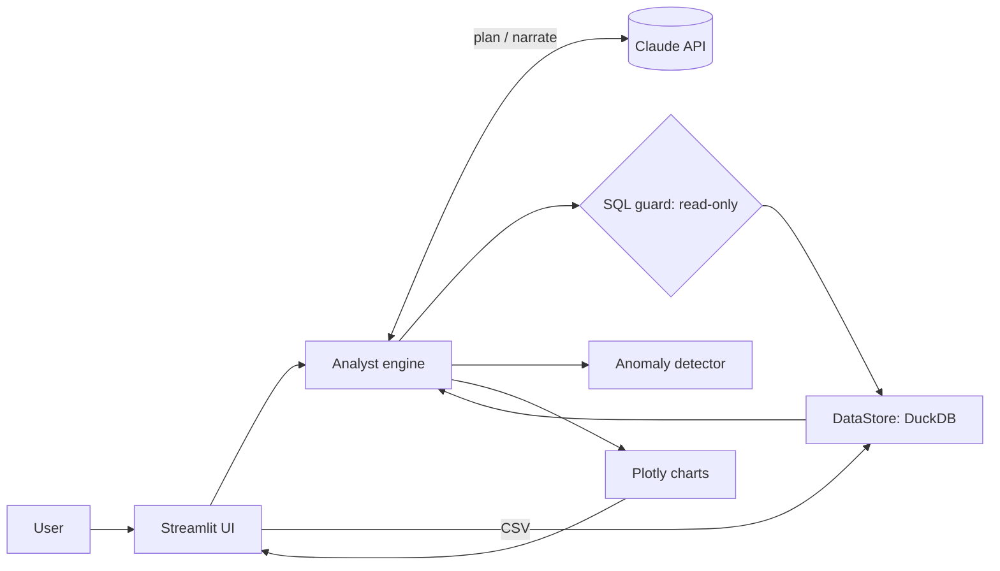
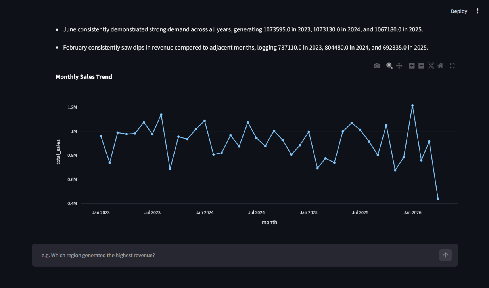
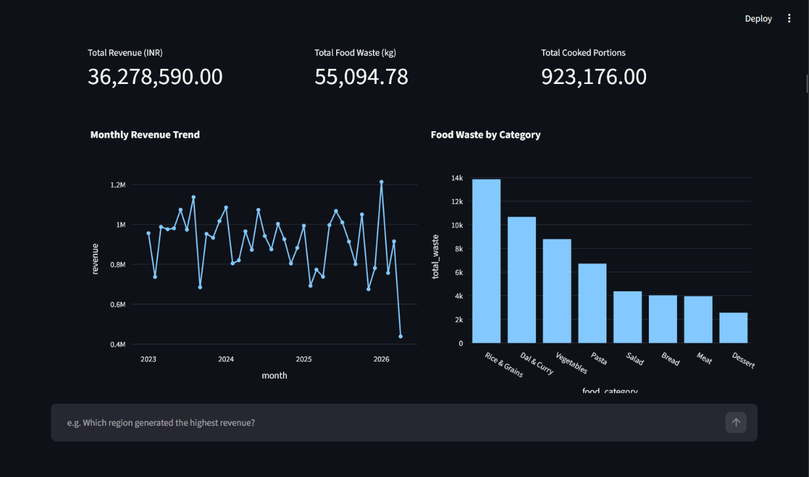
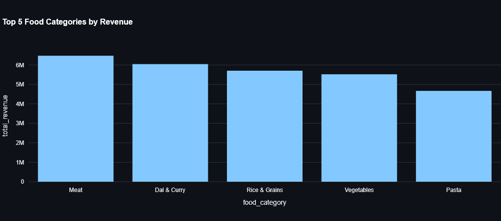

<<<<<<< HEAD
# CSV_Files-analysis
=======
# 📊 AI Data Analyst

Upload one or more CSV files and talk to your data in natural language. The app answers questions, writes SQL/Pandas, draws charts, builds dashboards, detects anomalies and explains its reasoning, with conversation memory for follow-ups.

## Features
- Upload and validate multiple CSVs (empty files, bad CSVs, duplicate columns, date detection)
- Natural-language questions with follow-ups ("now only for West")
- **Multi-file analysis**: tables are joined with real SQL (DuckDB)
- **Dashboard generation**: KPI cards plus varied charts from one request
- Charts: bar, line, pie, scatter, histogram
- SQL and equivalent Pandas code shown for every answer
- Explainable anomaly detection (z-score > 3 **and** outside 1.5×IQR)
- Reasoning panel on every answer

## Architecture
See [docs/architecture.md](docs/architecture.md).



| Module | Responsibility |
|---|---|
| `app.py` | Streamlit UI only; no business logic |
| `analyst/engine.py` | Plan → validate/execute → narrate; history; SQL self-repair |
| `analyst/data_store.py` | CSV validation, normalisation, DuckDB queries |
| `analyst/sql_guard.py` | Rejects anything except a single read-only SELECT |
| `analyst/anomaly.py` | Deterministic, explainable outlier detection |
| `analyst/llm.py`, `prompts.py` | API wrapper (injectable for tests) and prompt templates |
| `analyst/charts.py` | Chart spec → Plotly figure |

## Setup
```bash
git clone <your-repo-url> && cd ai-data-analyst
cp .env.example .env            # add your GEMINI_API_KEY (free) or ANTHROPIC_API_KEY
pip install -r requirements.txt
streamlit run app.py            # http://localhost:8501
```
**Docker:** `docker compose up --build`

The AI provider (Gemini or Claude), model and API key can also be set in the sidebar. If Gemini reports a quota error, pick another model there (e.g. `gemini-2.5-flash-lite`).

Click **Load sample datasets** in the sidebar (`sample_data/`: sales, customers, products) and try the example questions. Regenerate samples with `python scripts/make_sample_data.py`.

## Tests
```bash
pip install -r requirements-dev.txt && pytest -q
```
The engine is tested with a fake LLM, so the tests need no API key or network.

## Design decisions & assumptions
- **LLM plans, code computes.** The model produces SQL and a chart spec; DuckDB executes it, so figures are exact. The model then explains only the computed rows.
- **LLM output is untrusted.** SQL must pass a read-only guard (single SELECT/WITH, no file or DDL functions). Failing SQL is sent back to the model once for repair.
- **Privacy:** only schema, 3 sample rows per table and a small result preview are sent to the model, never the full dataset.
- Data lives in memory per session; nothing is persisted.
- The Pandas code shown is for reference and is not executed.
- A failed dashboard panel is skipped instead of failing the whole dashboard.

## Limitations
Very large files (hundreds of MB) are not optimised; chart choice is the model's best guess; no authentication.

## Screenshots & demo
- Screenshots: add to `docs/screenshots/` and link here
- Demo video (10–30 s): https://drive.google.com/file/d/1cSl9x2AOe_MB9XMhY8gzl2pJI433Ct7H/view?usp=drivesdk





>>>>>>> 5befe00 (Initial project submission)
